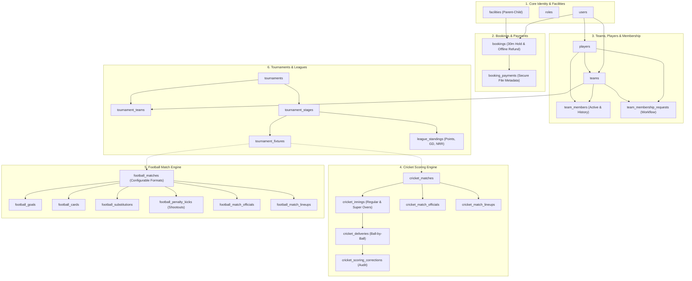
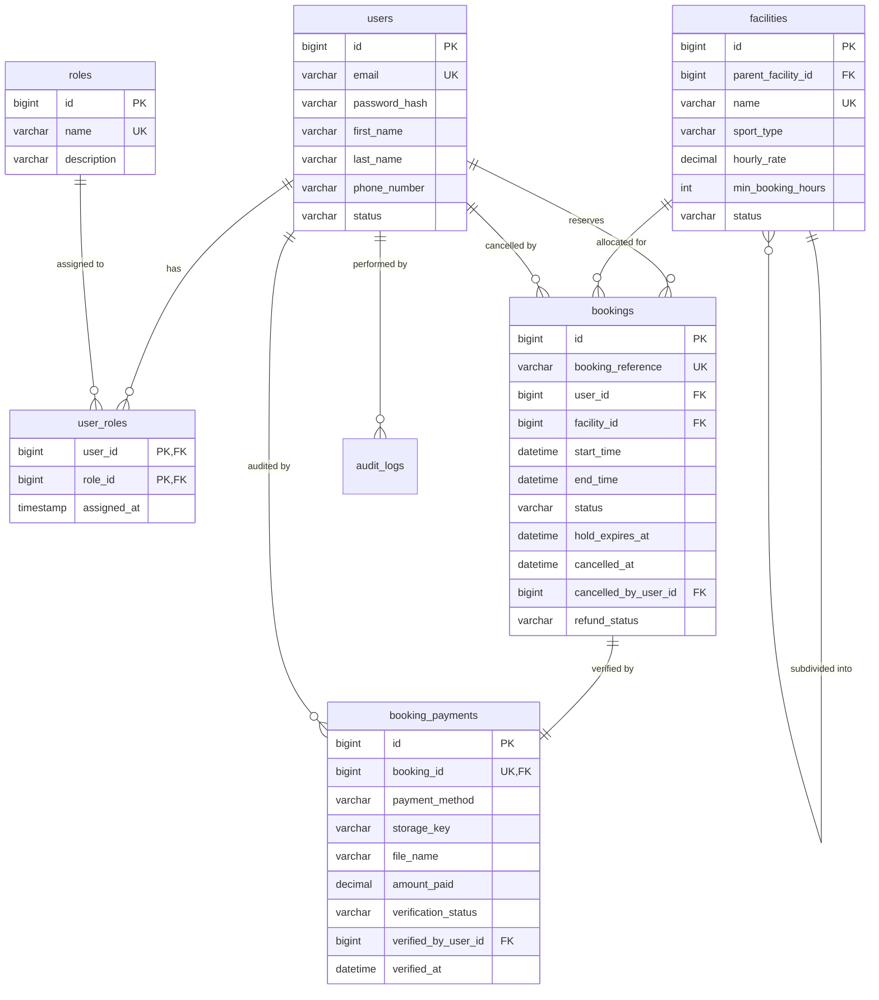
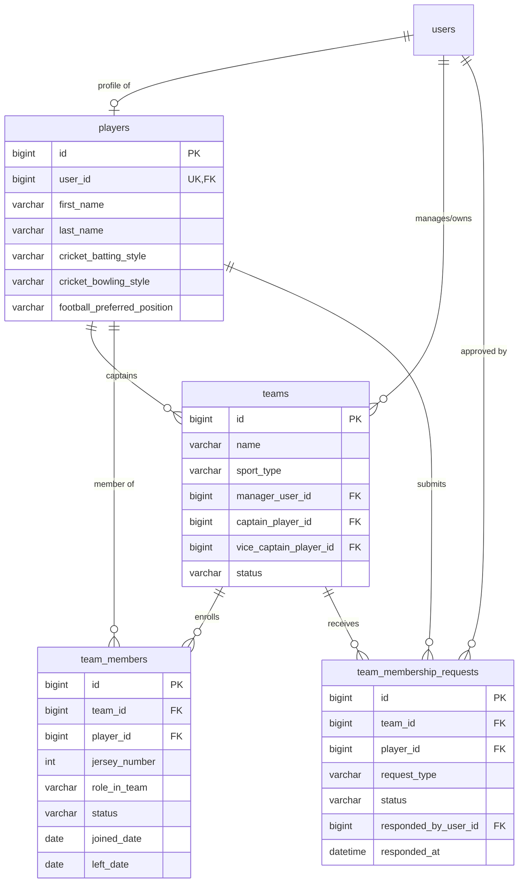
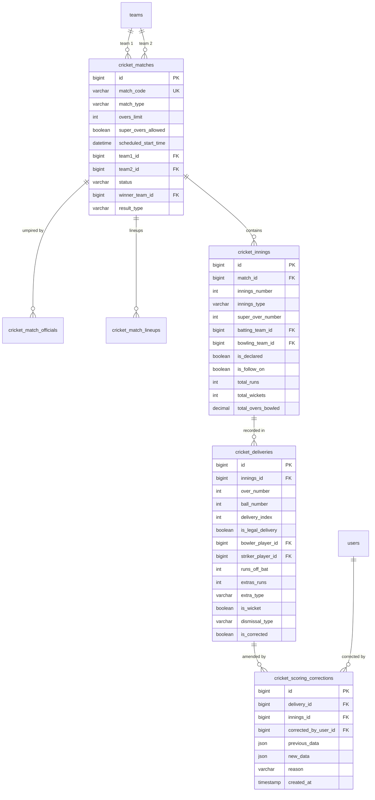
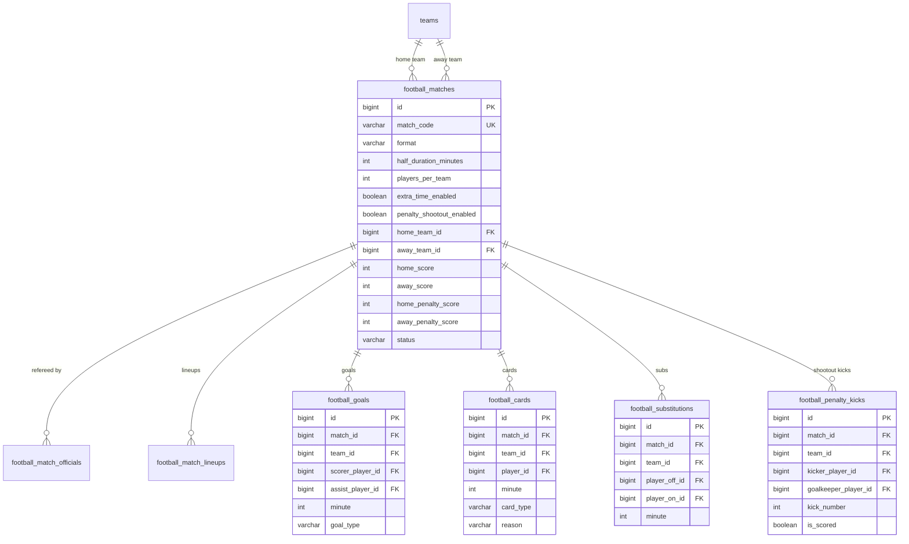
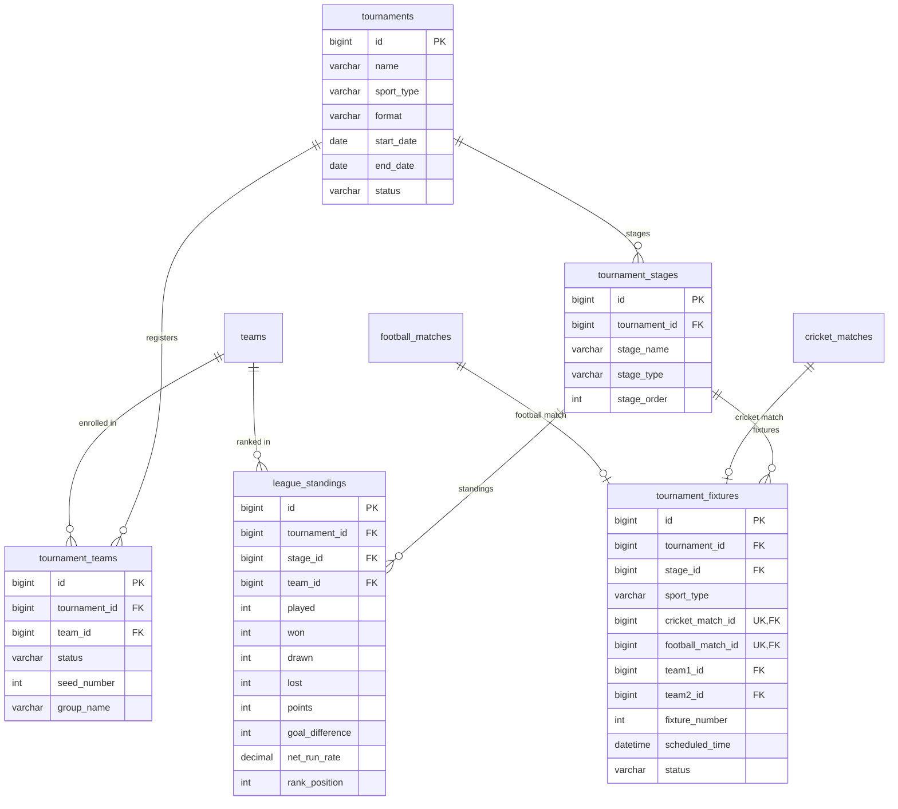

# Chama's Academy – Database Entity Relationships & Integrity Design (Final)

This document formalizes the entity-relationship architecture, foreign key constraints, cascade rules, and Mermaid ER diagrams for the **29 tables** in the Chama's Academy database.

---

## 1. High-Level Modular Entity Architecture

---

## 2. Module 1: Core Identity, Facilities & Bookings

### Entity Relationship Diagram

---

## 3. Module 2: Teams, Players & Membership Governance

### Entity Relationship Diagram

---

## 4. Module 3: Cricket Scoring Engine (With Super Overs & Corrections)

### Entity Relationship Diagram

---

## 5. Module 4: Football Match Engine (Configurable Formats & Shootouts)

### Entity Relationship Diagram

---

## 6. Module 5: Tournaments, Leagues & Standings

### Entity Relationship Diagram

---

## 7. Complete Referential Integrity & Cascade Strategy Matrix

| Parent Table | Child Table | Foreign Key Column | Action on Delete | Architectural Justification |
| :--- | :--- | :--- | :--- | :--- |
| `facilities` | `facilities` | `parent_facility_id` | `RESTRICT` | Parent facility cannot be deleted if sub-facilities exist. |
| `users` | `bookings` | `user_id` | `RESTRICT` | Financial auditability; users with bookings cannot be purged from DB. |
| `facilities` | `bookings` | `facility_id` | `RESTRICT` | Facilities with reservations cannot be deleted. |
| `bookings` | `booking_payments`| `booking_id` | `CASCADE` | Purging an unconfirmed draft booking deletes its payment metadata. |
| `users` | `booking_payments`| `verified_by_user_id`| `SET NULL`| Deleting an admin user preserves the audit history. |
| `users` | `players` | `user_id` | `SET NULL` | Unlinking a user account preserves the player's match history. |
| `teams` | `team_members` | `team_id` | `CASCADE` | Disbanding a team removes roster links. |
| `players` | `team_members` | `player_id` | `CASCADE` | Removing player removes active squad links. |
| `teams` | `team_membership_requests`| `team_id`| `CASCADE`| Disbanding team purges pending requests. |
| `cricket_matches` | `cricket_innings` | `match_id` | `CASCADE` | Deleting match deletes innings and child deliveries. |
| `cricket_innings` | `cricket_deliveries`| `innings_id` | `CASCADE` | Deleting innings deletes delivery log. |
| `cricket_deliveries`| `cricket_scoring_corrections`| `delivery_id`| `CASCADE`| Deleting delivery deletes its correction log. |
| `football_matches`| `football_goals` | `match_id` | `CASCADE` | Match deletion cleans up goals. |
| `football_matches`| `football_penalty_kicks`| `match_id`| `CASCADE`| Match deletion cleans up shootout kicks. |
| `tournaments` | `tournament_stages`| `tournament_id` | `CASCADE` | Tournament deletion cleans up stages and fixtures. |
| `tournaments` | `cricket_matches` | `tournament_id` | `SET NULL` | Deleting tournament converts matches to stand-alone friendlies. |
| `tournaments` | `football_matches`| `tournament_id` | `SET NULL` | Deleting tournament converts matches to stand-alone friendlies. |
